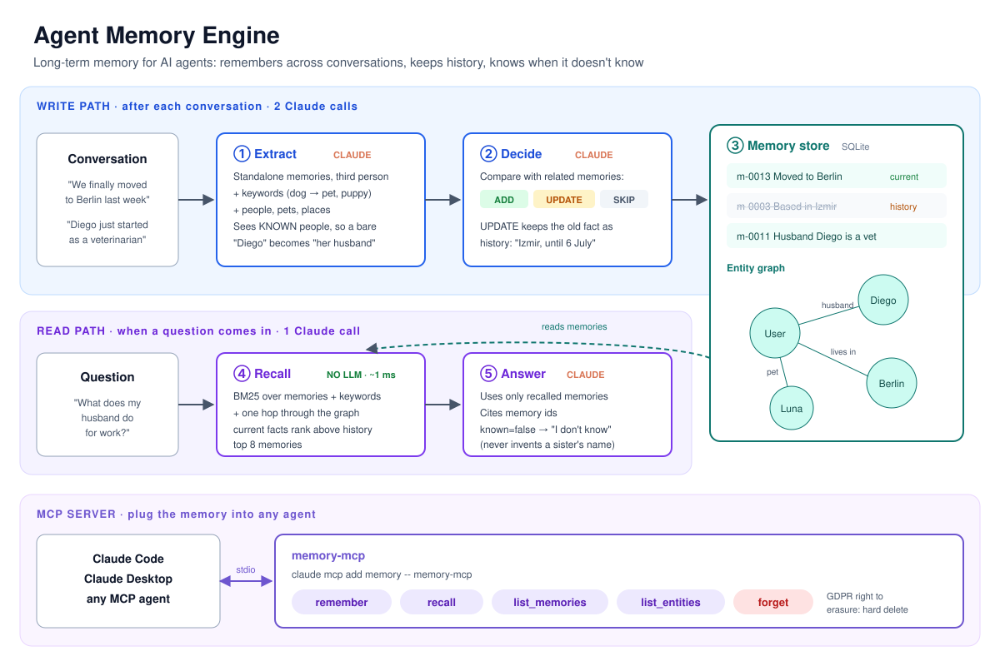
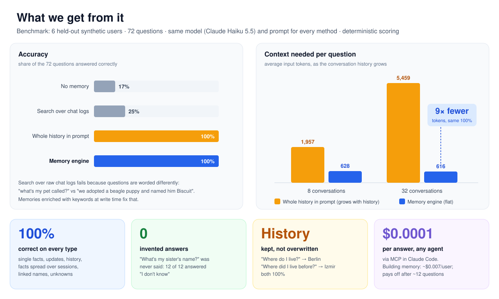

# 🧠 Agent Memory Engine: long-term memory for AI agents

**Give an AI assistant a memory that survives across conversations, keeps track of what changed, and knows when it doesn't know.** Claude extracts facts from conversations, decides whether each one is new, an update or already known, and stores them with their history. A hybrid recall layer finds the right memories later. It ships as an **MCP server**, so Claude Code or any MCP-capable agent can use it, and it comes with a benchmark against three ways of answering without it.


> Agent memory is one of the most active areas in open-source AI right now (mem0 is at ~67k GitHub stars). This project builds the core ideas from scratch, then **measures** them: does structured memory beat pasting the whole history into the prompt, and what does each part contribute?



---

## Results



Six synthetic users, 8 conversations each, 72 questions. Every method uses the same answering prompt and model (Claude Haiku 5.5); only the context differs.

| Method | Overall | Single fact | Knowledge update | History | Multi-session | Graph | Abstention | Input tokens / question | Cost / question |
|---|---|---|---|---|---|---|---|---|---|
| No memory | **17%** | 0% | 0% | 0% | 0% | 0% | 100% | 433 | $0.00007 |
| Chunk RAG (BM25 over raw messages) | **25%** | 25% | 0% | 0% | 0% | 0% | 100% | 501 | $0.00010 |
| Full context (whole history in the prompt) | **100%** | 100% | 100% | 100% | 100% | 100% | 100% | 1,957 | $0.00029 |
| **Memory engine** | **100%** | 100% | 100% | 100% | 100% | 100% | 100% | **628** | **$0.00010** |
| Memory engine, no graph hop (ablation) | 99% | 100% | 100% | 100% | 100% | 83% | 100% | 587 | $0.00009 |

**Longer histories** (24 extra small-talk conversations per user, 32 in total, same 72 questions):

| Method | Overall | Input tokens / question | Cost / question |
|---|---|---|---|
| Full context | 100% | 5,459 (2.8× more than with 8 conversations) | $0.00066 |
| **Memory engine** | **100%** | **616 (flat)** | **$0.00009** |

What this shows, honestly:

- **Same accuracy as brute force, at a fraction of the context.** With 8 conversations the memory engine uses 3× fewer input tokens than pasting the history; with 32 it's **9× fewer**, and the gap keeps growing because recall always returns at most 8 memories.
- **Memory isn't free to build.** Extraction plus decisions cost $0.0415 for 6 users × 32 conversations (~$0.007 per user). At these prices it pays for itself after about **12 questions per user**; after that every question is cheaper.
- **At this scale, full context is a perfectly good answer.** Haiku read 5,000 tokens of chat without missing anything. Memory wins on cost and on histories too long for a context window, not on accuracy here.
- **Naive RAG over chat logs fails badly (25%).** "What's my pet called?" shares no words with "we adopted a beagle puppy and named him Biscuit", and "which city do I live in" retrieves the colleague who moved. Turning chats into enriched, standalone memories is what fixes it. (A dense-embedding chunk retriever would do better than this BM25 baseline; it is not included yet.)
- **The graph hop barely matters now, and that's a finding.** Once the extractor sees the known people ("Diego = husband"), relationships are resolved when the memory is written, so recall rarely needs the graph. Without the graph, one answer out of 72 hedged.
- **Two bugs the benchmark caught in my own work:** the extractor stored "the user's *friend* Diego" before known-entity context was added, and my test data called a *tabby* a breed. Claude answered "tabby is a coat pattern, not a breed", which was right, so I fixed the data rather than the model.

Total API cost for all the runs above: about $0.25.

## How it works

```text
 conversation ──► 1. EXTRACT  Claude turns it into standalone memories
                     "The user's husband Diego started a new job as a veterinarian."
                     + keywords (work, career, occupation) + entities (Diego: person)
                     + KNOWN PEOPLE AND PETS from memory, so a bare "Diego" is resolved
              ──► 2. DECIDE   for each candidate, Claude sees the related existing memories:
                     ADD (new) · UPDATE (replaces an outdated memory, kept as history) · SKIP (known)
              ──► 3. STORE    SQLite: memories + entities + links, superseded rows keep valid_until

 question ─────► 4. RECALL    BM25 over memory text + LLM-written keywords, one hop through the
                     entity graph, current facts ranked above history  (no LLM call, ~1 ms)
              ──► 5. ANSWER   Claude answers from recalled memories only, cites memory ids,
                     and returns known=false instead of guessing
```

| Design choice | Why |
|---|---|
| **History, not overwrite** | "We moved to Berlin" supersedes "lives in Pune" but keeps it, with the date. The engine answers both "where do I live?" and "where did I live before?". |
| **Write-time enrichment instead of a vector DB** | The extractor attaches synonyms and categories (a beagle gets *dog, pet, puppy*), so plain BM25 matches paraphrased questions. Recall needs no embedding model and no LLM call. |
| **Known-entity context at extraction** | Without it, "Diego started a new job" in a later conversation was stored as *"the user's friend Diego"*: a wrong memory. Showing the extractor who's already known fixed it. |
| **Structured outputs everywhere** | Extraction, decisions and answers are JSON-schema constrained, so nothing has to be parsed out of free text. |
| **Abstention is a first-class answer** | `known: false` is part of the answer schema and is scored. An assistant that invents a sister's name is worse than one that says "I don't know". |
| **Right to be forgotten** | `forget` hard-deletes a memory and its entity links, in line with GDPR's right to erasure. |

## The benchmark

Synthetic users talk to an assistant over 8 weekly conversations (plus optional small-talk-only conversations to grow the history). Generated deterministically, no LLM involved, so every answer is known. Question types follow long-term-memory benchmarks such as **LongMemEval** and **LoCoMo**:

| Type | Example | What makes it hard |
|---|---|---|
| single fact | "What's my pet called?" | Worded differently from "we adopted a beagle puppy and named him Biscuit"; a friend's dog is also mentioned |
| knowledge update | "Which city do I live in these days?" | The city, job and diet all change later; only the newest is right |
| history | "Where was I living before the move?" | Needs the superseded memory, not the current one |
| multi-session | "Which countries have I travelled to recently?" | Three trips in three different conversations; all must be listed |
| graph | "What does my husband do for work?" | "My husband Diego" and "Diego started as a vet" are weeks apart and share only a name |
| abstention | "What's my sister's name?" | Never mentioned; the right answer is "I don't know" |

Scoring is deterministic string matching on the expected values; no LLM judge. **Persona 0 was used while developing the prompts and retrieval; the reported numbers use personas 1-6, which were never looked at during development.**

## Use it from Claude Code (MCP)

```bash
pip install -e .
claude mcp add memory -- memory-mcp        # database at ~/.agent-memory.db
```

| Tool | What it does | LLM calls |
|---|---|---|
| `remember(text)` | extract + decide + store | 2 (Haiku 5.5 by default, `AGENT_MEMORY_MODEL` to change) |
| `recall(query, k)` | ranked memories, each marked current or "no longer true since …" | 0 |
| `list_memories(include_history)` | everything stored about a user | 0 |
| `list_entities()` | people, pets, places and organisations, with memory counts | 0 |
| `forget(memory_id)` | permanent delete | 0 |

## Quick start

```bash
git clone https://github.com/abpandey-dev/agent-memory-engine.git && cd agent-memory-engine
python -m venv .venv && source .venv/bin/activate
pip install -e ".[dev]"

memory show-data --persona 1              # see a synthetic user's conversations and questions (free)
pytest -q                                 # 19 tests, scripted fake model, no API key needed
```

With Claude (needs `ANTHROPIC_API_KEY`; real calls cost money):

```bash
memory demo --persona 0 --model claude-haiku-5-5        # ~$0.005: build memory, answer 12 questions
memory bench --model claude-haiku-5-5 --personas 6       # ~$0.08: the full comparison
memory bench --model claude-haiku-5-5 --filler 24 --methods full_context memory   # long histories
```

Real output of `memory demo --persona 0` (Haiku 5.5), lightly trimmed. History is kept, and Claude decided on its own that going vegetarian replaces "comfort food is lamb kebabs":

```text
priya-s04: +1 added, 1 updated [('m-0004', 'm-0009')], 0 skipped
priya-s06: +1 added, 1 updated [('m-0003', 'm-0013')], 0 skipped
priya-s07: +1 added, 1 updated [('m-0002', 'm-0014')], 0 skipped

  m-0003 The user is based in Izmir.   [superseded 2026-07-06 by m-0013]
  m-0004 The user's comfort food is lamb kebabs, which they could eat every week.   [superseded 2026-06-22 by m-0009]
  m-0005 The user is married to a husband named Diego.
  m-0009 The user has decided to become vegetarian, mostly for health reasons, as of June 2026.
  m-0011 The user's husband Diego recently started a new job as a veterinarian with intense shifts.
  m-0013 The user moved to Berlin, Germany in late June 2026, and their new flat was full of boxes shortly after.

✓ Where was I living before the move?
    You were living in Izmir before the move to Berlin.  (memories: m-0003, m-0013)
✓ Which countries have I travelled to recently? List them all.
    Iceland (a trip for a friend's wedding, returning around June 2026), Peru (a two-week trip returning in
    early June 2026), and Kenya (a long weekend trip, returning July 12, 2026).  (memories: m-0010, m-0006, m-0015)
✓ What does my husband do for work?
    Your husband Diego recently started a new job as a veterinarian with intense shifts.  (memories: m-0011, m-0005)
✓ What's my sister's name?
    I don't know your sister's name; your memories don't mention a sister.  (memories: -)

12/12 correct; 27 calls, 23,541+4,009 tokens, $0.0044
```

## Project layout

```text
src/agent_memory/
  store.py        # SQLite: memories, entities, links, supersede history, forget
  retrieval.py    # BM25 + stemming, entity-graph hop, history down-weighting
  engine.py       # extract -> decide -> store; recall -> answer (prompts + JSON schemas)
  llm.py          # structured-output calls, token and cost accounting, refusal handling
  mcp_server.py   # 5 MCP tools over stdio (MCP Python SDK 2.x)
  dataset.py      # synthetic multi-session users with known answers
  bench.py        # the four methods + ablation, deterministic scoring
  cli.py          # `memory` command
tests/            # scripted fake Claude client, in-process MCP client
docs/             # architecture and results diagrams (SVG)
```

## Limits and next steps

- **Synthetic data.** Conversations are templated, so they are cleaner than real chat logs. The next step is running the public **LongMemEval** set.
- **Lexical recall.** Write-time keywords did the job here, but a dense-embedding retriever (and a dense chunk-RAG baseline, which would beat the BM25 one shown here) should be compared at larger scale.
- **One user per question.** Shared memory across a team (and access control on it) is not covered.
- **Decay and consolidation.** Old, low-importance memories are kept forever; a consolidation pass that merges and summarises them is the next feature.

Built with synthetic data only. No real personal data is used.
